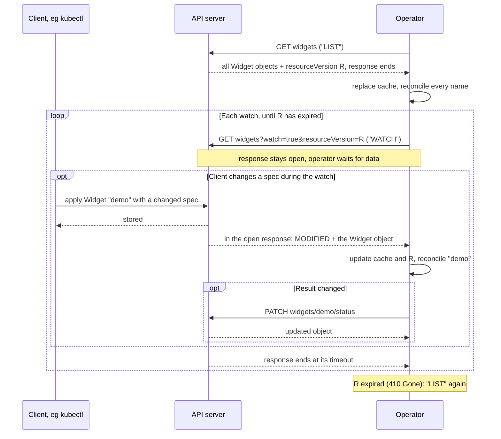

# Operator and API server

An operator makes _three_ kinds of call to the Kubernetes API server, and its control loop _receives none_: 
- lists the objects of its resource type
- watches their changes
- writes each result to an object's status

Read this page to follow the operator code at any of the [three levels](../readme.md#project-overview); the control loop itself is explained without it in [control_loop/](../control_loop/readme.md). The pages under [Details](#details) are optional: each answers one further question.

In the table, `...` stands for `/apis/example.com/v1/namespaces/default`: where the API server serves the Widgets of the namespace `default`.

| call | HTTP request | what it returns or changes |
|---|---|---|
| "LIST" | `GET .../widgets` | every Widget object that exists now, and a position in the change history |
| "WATCH" | `GET .../widgets?watch=true&resourceVersion=...` | each change after that position, as it happens |
| status `PATCH` | `PATCH .../widgets/demo/status` | writes the result into the object's `status` |

"LIST" and "WATCH" are the labels these pages and the code comments use for the two kinds of read; both are HTTP `GET` requests.

> _Careful:_ These are calls to the API of the Kubernetes API server. 
(The web service variant of the [_Structured_](../control_loop/readme.md) level has an HTTP API of its own with similar URLs, eg `/widgets/demo`; that variant never calls the API server. The two APIs are compared in [Two variants](../control_loop/readme.md#two-variants-web-service-or-kubernetes-operator)).
> 
> Two things leave the three _operator_ calls _unchanged_:
> 
> - *Where* the operator runs. In a Pod of the cluster, started by a Deployment, or as a process outside the cluster: it makes the same three calls. Only how it proves its identity differs ([access.md](access.md)).
> - *What* the operator controls. Its internal state can be other Kubernetes objects, eg Pods; something outside Kubernetes, eg a cloud database; or, as here, a counter in memory. The three calls concern only the Widget objects, which hold the spec and the result. An operator that controls other Kubernetes objects makes further calls to the API server for them; this example makes none.

## The API server does not call the operator

**A watch is a request the operator sends, not a callback it receives.** The API server keeps the HTTP response to that `GET` open and writes one JSON line into it for each change. The operator waits while reading that response.

So nothing is registered and no port is opened for the loop:

- the CustomResourceDefinition (CRD) registers the resource type, not the operator;
- the Role permits the calls, but does not subscribe the operator to anything;
- the running operator chooses what to list and watch.

`kubectl apply` returns when the object is stored. The operator's work happens afterwards and separately.

## List, then watch

Solid arrows are requests or local calls; dashed arrows are response data.

1. **"LIST"** returns every Widget object and a position `R`. The operator replaces its cache with these objects. It then reconciles every listed name, and every name it knew before that is no longer listed: a Widget deleted while the operator was not watching.
2. **"WATCH" from `R`** returns each later change as a notification: its type (`ADDED`, `MODIFIED`, `DELETED`) and the whole object as it is now, not a difference. The operator updates its cache and `R`, then reconciles that name.
3. **The response ends** at a timeout the operator requested (30 s in the minimal controller, 300 s in control_loop/). The operator watches again from the latest `R`; no new list is needed.
4. **`R` has expired** (`410 Gone`): the operator starts again at step 1.

**Both reads are needed.** A watch reports only changes after `R`, so the list supplies the objects that already exist and reveals deletions missed meanwhile. Listing repeatedly, without a watch, would notice a change only at the next list.

`MODIFIED` covers a change to `spec`, `status` or metadata, so the operator's own status `PATCH` comes back as a notification too. Reconciling that name again is harmless: the comparison finds nothing to change.

## The position: resourceVersion

**`resourceVersion` is a string the API server assigns to mark a position in the change history.** The list response carries one, and so does each watched object. The operator only stores the latest one seen and passes it to the next watch. It is neither the API version (`v1`) nor a revision of the spec.

- **It expires.** The API server keeps the change history only briefly, 5 minutes by default. A watch from an older position fails with `410 Gone`, and only a new "LIST" recovers.
- **Bookmarks keep it fresh.** With `allowWatchBookmarks=true`, the API server may send `BOOKMARK` notifications: a newer `resourceVersion` and no object change. A watch on which nothing changes then still ends with a recent position. The API server need not send them, so the operator still handles `410 Gone`.

## The result goes to status

**The operator writes the result with a `PATCH` to `.../widgets/demo/status`, and only when the result changed.**

- **`status` is a subresource**, enabled in the CRD. A write to `.../status` changes only `status`; a write to the object itself leaves `status` unchanged. A client's `kubectl apply` therefore cannot overwrite the result, and the operator's `PATCH` cannot change the spec.
- **An unchanged result is not written.** The operator first compares the result with the `status` of the object in its cache, which saves the call.

## What the cluster needs first

| need | supplied by | without it |
|---|---|---|
| the Widget resource type | [00-crd.yaml](../manifests/00-crd.yaml) | the API server rejects Widget objects and the operator's calls |
| permission for the three calls | outside the cluster: your own `kubectl` permissions. In a Pod: [02-rbac.yaml](../manifests/02-rbac.yaml), explained in [access.md](access.md) | the API server refuses the calls with `403 Forbidden` |

[manifests](../manifests/readme.md) has the commands.

## Changes a Widget watch does not report

**The watch reports changes to Widget objects, not changes to the internal state.** In the Widget example only `reconcile()` changes the internal state, so nothing is missed. An operator whose internal state others can change needs a further trigger:

- **for Kubernetes objects it created**, eg Pods: it watches those too, and a change there reconciles the owning object (controller-runtime: `Owns()`);
- **for a system it cannot watch**, eg a cloud resource: `reconcile()` asks to run again after a delay (controller-runtime: `RequeueAfter`).

## Details

| page | question it answers |
|---|---|
| [http](http.md) | What do the three requests and the open watch response look like as HTTP? |
| [objects](objects.md) | What are a resource type, a CRD and an object; who sets which field; what identifies an object? |
| [access](access.md) | How is an operator in a Pod identified, and what is it permitted to do? |
| [webhooks](webhooks.md) | When does the API server call operator code after all? Admission webhooks, which this example does not use. |

Reference: [Kubernetes API concepts: watches, resourceVersion, bookmarks](https://kubernetes.io/docs/reference/using-api/api-concepts/).
