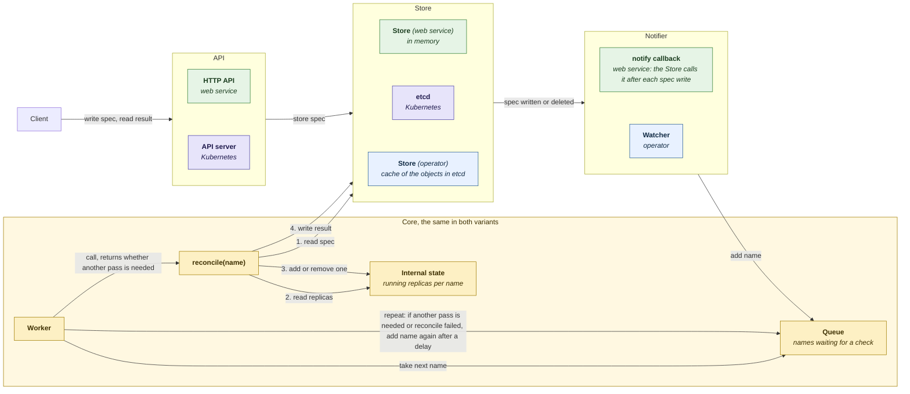
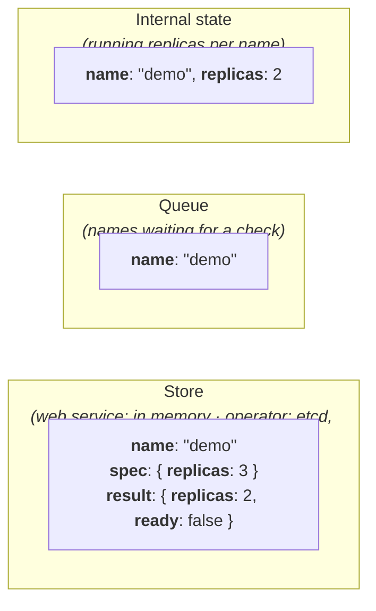
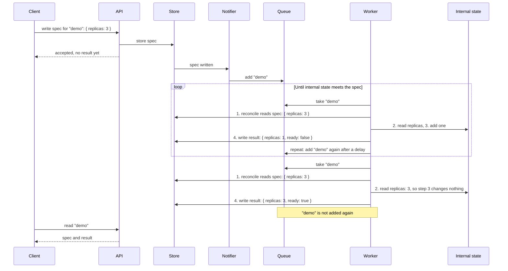

# 2 Structured Control loop (Go and Python)

A control loop keeps an internal state meeting a spec: it repeatedly compares the two, changes the internal state where they differ, and publishes a result.
Each such pass is called a **reconcile**; in the code it is one call of the function `reconcile(name)`.
 The terms spec, internal state and result are defined in [Operator (Pattern)](../../readme.md#control-loop).

The example runs as either of two variants with the same core: a **web service**, without Kubernetes, or a **Kubernetes operator**. 
The web service is there for comparison: it is still a control loop, but not a Kubernetes operator (see also [_Why a web service variant?_](../../readme.md#project-overview)). 
This page first describes what both have in common; The [Two variants](#two-variants-web-service-and-kubernetes-operator) section below, then shows how they differ.

### Example: Widget replicas

| term | in this example |
|---|---|
| **spec** | `replicas: 3`, set by a client for the Widget named `"demo"` |
| **internal state** | the number of replicas actually running for `"demo"`, a counter in memory |
| **result** | `replicas: 2, ready: false`: what the loop last observed |

One action adds or removes **one** replica, so reaching the spec takes several passes, and the result shows the progress.

### Actors and calls



Arrows point from caller to callee. The numbers are the four steps of the [control loop](../../readme.md): one call of `reconcile()` reads the spec (1) and the running replicas (2), adds or removes one replica (3) and writes the result (4). The Worker closes the loop (repeat): it adds the name to the Queue again, takes it later, and calls `reconcile()` again.

API, Store and Notifier are the three parts each variant fills differently: **green** for the web service, **blue** for the operator (our code), **indigo** for Kubernetes itself. The **amber** Core is the same in both. Only `reconcile()` changes the internal state; the Client and the API only read and write specs and results.

| part | role |
|---|---|
| API | where the Client writes specs and reads results |
| Store | keeps the spec and latest result of each Widget; in the operator, Kubernetes keeps them in etcd and the operator's Store reads them through a cache |
| Notifier | adds a Widget's name to the Queue when its spec is written or deleted; in the web service, a callback (`Queue.add`) that the Store calls |
| Core: Queue, Worker, `reconcile()`, Internal state | the inner control loop both variants share: decides and acts, one name at a time |

**One Worker, one name at a time.** Each variant runs two threads, so that two things can wait at the same time: the API side waits for requests or changes, and the Worker waits for names in the Queue. There is a single Worker, not a pool, so `reconcile()` never runs twice at once and the Internal state needs no protection against that. Several Workers would be faster, but two of them could then handle the same name at once; a pool needs a Queue that hands out each name to only one Worker at a time, as _controller-runtime_'s does. The threads share the Store and the Queue, which therefore lock.

### What is stored where



| place | holds | written by |
|---|---|---|
| Store | the **spec** and the latest **result** of each Widget, under its name | spec: Client, through the API. Result: `reconcile()` |
| Queue | **names** to check; no specs, no commands | Notifier, when a spec is written or deleted; Worker, when `reconcile()` needs another pass or fails |
| Internal state | the running replicas of each Widget | `reconcile()` only |

A queued name means only "check this Widget". The Worker reads the current spec when it takes the name, so writing the spec twice before a check leads to one check of the latest spec. A name already in the Queue is not added again.

### One spec change



Writing the spec returns as soon as it is stored; the loop's work happens afterwards. The Client follows progress by reading the result.

### How each situation is handled

`reconcile(name)` makes the same comparison every time, so these cases need no separate code paths:

| situation | what `reconcile()` finds | action |
|---|---|---|
| spec created or raised | fewer replicas than specified | add one, write result, add the name to the Queue again |
| spec lowered | more replicas than specified | remove one, write result, add the name to the Queue again |
| spec deleted | no spec | remove the internal state; no result to write |
| internal state already meets the spec | equal replicas | write result `ready: true`; do not add the name again |
| an action fails | (error) | add the name to the Queue again after a delay; the next pass compares again |

Calling `reconcile()` more often than needed is harmless: it changes nothing when the internal state already meets the spec.

**No periodic recheck in this example.** Only `reconcile()` changes the internal state, so it cannot change unnoticed. A control loop whose internal state can also be changed by something else, eg a person or another system, also adds every name to the Queue periodically, so that such changes are found and corrected.

## Variants

Two alterative variants (Web Service and Kubernetes Operator) implemented and run the same Core. 
Each supplies one of the three parts in [Actors and calls](#actors-and-calls) (API, Store, Notifier); the diagrams below use the same names and colours.

| part | web service | Kubernetes operator |
|---|---|---|
| API | our HTTP API: `PUT`, `GET`, `DELETE /widgets/{name}` | the Kubernetes API server, eg used with `kubectl` |
| Store | Store (web service), in memory | etcd, as the `spec` and `status` of each Widget object. Store (operator) reads a local copy (cache) of these objects and writes `status` through the API server |
| Notifier | the Store's notify callback (`Queue.add`), called after each spec write or delete | Watcher, on each change it receives from the API server |

> _Careful: The two APIs are easy to confuse: both are HTTP, with URLs ending in `widgets/{name}`._
> 
> | | web service | Kubernetes operator |
> |---|---|---|
> | the API is part of | our code | Kubernetes |
> | example URL | `/widgets/demo` | `/apis/example.com/v1/namespaces/default/widgets/demo` |
> | the Client | eg `curl` | eg `kubectl` |
> | our process | receives the Client's calls and makes none | makes calls to the API server and receives none: [Operator and API server](../../api_server/readme.md) |

- #### 1) Web Service 
    one process; the colours are those of [Actors and calls](#actors-and-calls).

    ```mermaid
    flowchart LR
        client["Client"]
        subgraph process["Web service"]
            api_web["`**API**
            _HTTP API_`"]
            store_web["`**Store**
            _in memory_`"]
            notifier_web["`**Notifier**
            _the Store's notify callback_`"]
            core["`**Core**
            _Queue, Worker, reconcile(), Internal state_`"]
        end
        client -->|"PUT, GET, DELETE /widgets/name"| api_web
        api_web -->|"write spec, read spec and result"| store_web
        store_web -->|"spec written or deleted"| notifier_web
        notifier_web -->|"add name"| core
        core -->|"1. read spec, 4. write result"| store_web
        classDef web fill:#e6f4e6,stroke:#2e7d32,color:#1b3d1f
        classDef core fill:#fdf0c4,stroke:#a07d00,color:#3d2f00
        class api_web,store_web,notifier_web web
        class core core
    ```

- #### 2) Kubernetes Operator
    The API and the Store's data (etcd) belong to the cluster; the operator process adds the Watcher as Notifier and its own Store, a cache.

    ```mermaid
    flowchart LR
        client["`Client
        _eg kubectl_`"]
        subgraph cluster["Kubernetes cluster"]
            api_op["`**API**
            _API server_`"]
            etcd["`**Store**
            _etcd_`"]
        end
        subgraph process["Operator"]
            notifier_op["`**Notifier**
            _Watcher_`"]
            store_op["`**Store**
            _cache of the objects in etcd_`"]
            core["`**Core**
            _Queue, Worker, reconcile(), Internal state_`"]
        end
        client -->|"apply, get, delete Widget objects"| api_op
        api_op -->|"store objects"| etcd
        notifier_op -->|"#quot;LIST#quot; and #quot;WATCH#quot; Widget objects"| api_op
        notifier_op -->|"update cache"| store_op
        notifier_op -->|"add name"| core
        core -->|"1. read spec, 4. write result"| store_op
        store_op -->|"PATCH status"| api_op
        classDef operator fill:#e8f1ff,stroke:#245b8f,color:#102a43
        classDef kubernetes fill:#e7e4fa,stroke:#4a3fa8,color:#1f1a4d
        classDef core fill:#fdf0c4,stroke:#a07d00,color:#3d2f00
        class api_op,etcd kubernetes
        class notifier_op,store_op operator
        class core core
    ```

- **The boundary** is two methods: the Core only reads a Widget's spec and writes its result. Each variant's Store supplies exactly these two methods, so the Core does not depend on either variant.
- **The result becomes the object's `status`** in the operator, readable with `kubectl get widget demo -o yaml`.
- **The Watcher** first lists all Widget objects ("LIST"), then receives each change as it happens ("WATCH"), and lists again if the API server no longer has the changes it missed (410 Gone). Every list queues each listed name and each name it no longer finds, so a deletion missed meanwhile still reaches `reconcile()`. These calls are explained in [Operator and API server](../../api_server/readme.md).
- **Internal state is still in memory.** After an operator restart, replicas start again from 0; the specs, stored in Kubernetes, are not lost.

## Implementations and tests

- [Python](python/readme.md): standard library only.
- [Go](go/readme.md): standard library only; the same parts, names and tests.
- [Minimal and library controllers](../readme.md): the same loop with less code of our own, as one hand-written file, or on _controller-runtime_.

Each implementation has unit tests for each part, and a smoke test per variant that runs the whole process: the web service over HTTP, the operator against an in-memory stand-in for the API server. Neither needs a cluster. CI runs them on every push.
