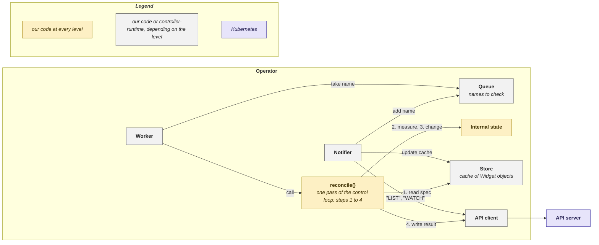

# Levels

As [introduced](../readme.md#project-overview), the example code implements the same control loop at three _levels_:

- [**_Minimal_**](1_minimal/readme.md): the whole loop in one Python file.
- [**_Structured_**](2_structured/readme.md): the same loop as separate named parts with tests, in Python and Go. Each can also run as a web service without Kubernetes, for comparison.
- [**_Library_**](3_library/readme.md): the same loop on _controller-runtime_.

All three use the _Widget_ replicas example, the terms spec, internal state and result, and the step numbers 1 to 4 of [Kubernetes Operators](../readme.md).

## Which parts are our code

The Widget operator can be decomposed into 7 parts. The decomposition is the same at every level:

Arrows point from caller to callee. The numbers are the four steps of the [control loop](../readme.md#control-loop); all four start at `reconcile()`. [Structured](2_structured/readme.md#actors-and-calls) draws the same parts in more detail.

|  | what it does |
|---|---|
| **API client** | makes the calls to the API server |
| **Notifier** | finds out which Widgets changed, by "LIST" and "WATCH" ([explained](../api_server/readme.md#list-then-watch)) |
| **Store** | keeps a local copy (cache) of the Widget objects |
| **Queue** | holds the names of the Widgets to check |
| **Worker** | takes one name at a time from the Queue and calls `reconcile()` for it |
| **`reconcile()`** | makes one pass of the loop for one Widget |
| **Internal state**| what that pass measures and changes |

`reconcile()` and the Internal state are what make this an operator for Widgets, so they are our code at every level (at the Library level the function is named `Reconcile`).

The other five parts are the same for any operator, whatever it controls. They can therefore be written by hand or taken from _controller-runtime_, and that is where the levels differ. The Structured column describes its Kubernetes operator variant.

|  | Minimal | Structured | Library |
|---|---|---|---|
| **API client** | ours, a few lines | ours | _controller-runtime_ |
| **Notifier** | ours, inline in `run()` | ours: the Watcher | _controller-runtime_, which calls this part the reflector |
| **Store** | ours: a dictionary | ours: Store (operator), reached only through the two `WidgetStore` methods, which is what allows the web service variant | _controller-runtime_, which calls this part the informer cache |
| **Queue & Worker** | none: each change is handled on the thread that reads the watch, which pauses there afterwards, so no other change is read meanwhile | ours: one Worker. The pause between two passes for one Widget is a delayed Queue entry, so other Widgets are handled meanwhile | _controller-runtime_, which calls the Queue the work queue: one worker by default, several possible |

> _Why Library comes last in the reading order:_
> Its mechanism is inside _controller-runtime_, not visible in our code. Minimal and Structured show what _controller-runtime_ does.

## Other differences

| | Minimal | Structured | Library |
|---|---|---|---|
| next pass while the spec is not met | the status `PATCH` comes back from the watch as a MODIFIED change, which calls `reconcile()` again | the Worker adds the name to the Queue again after a delay | `Reconcile` returns `RequeueAfter`; changes that leave the spec unchanged, such as our own status `PATCH`, are filtered out |
| after an error | everything is listed again | only that name is retried, after a fixed delay | only that name is retried, after a growing delay |
| tests | none | each part, and the whole operator against a stand-in for the API server | none |

## Run and test them

Each level's own readme shows how: [Minimal](1_minimal/readme.md), [Structured in Python](2_structured/python/readme.md), [Structured in Go](2_structured/go/readme.md), [Library](3_library/readme.md).
