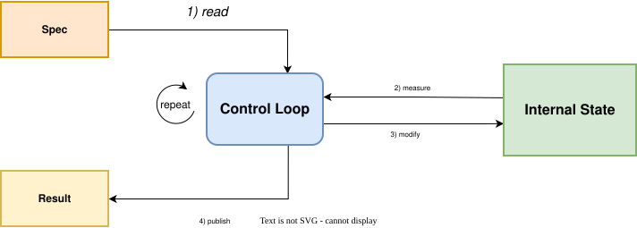

# Kubernetes Operators

A _Kubernetes Operator_ is a kind of _control loop_: a program that keeps comparing what was asked for with what actually exists, and changes what exists until it matches. The same pattern is followed by every operator in Kubernetes, both built-in and custom.

> Kubernetes docs call the built-in ones _controllers_ and reserve _operator_ for custom ones; but the mechanism is the same.

This repository builds a single illustrative operator in three ways: 
- One hand-written file
- Separate tested parts
- Using `controller-runtime`, the _**Go**_ library that most production operators are built with.
  
  ####
  > **_Go_** is the de facto standard programming language for Kubernetes operators and much of the cloud itself, because Kubernetes and many other major cloud tools are written in it. Its strengths in concurrency, single static binaries, and small resource footprint make it especially well-suited to this work. _(Alternative implementations in both Go and Python are presented in this project for comparative purposes)._

The code then shows the mechanism at work:

- **What Kubernetes stores, and what it leaves to the operator.** Kubernetes stores the request and the operator's report on it. Acting on the request is the operator's code alone.
- **Who calls whom.** The operator makes every call: it asks the API server for the objects and their changes, and writes its report back. Its loop needs no callback from Kubernetes and no listening port ([Operator and API server](api_server/readme.md)).
- **What a library takes over.** From one version to the next, parts written by hand (the watch, the cache, the queue, the worker) are replaced by the library, until only the decision code is ours.
- **That the loop does not depend on Kubernetes.** The same core also runs as a plain web service, so it runs and is tested without a cluster.

The concept comes first, on this page. [Project Overview](#project-overview) then lists the code in reading order.

## _Control Loop_
A control loop is **a** process that repeats indefinitely to:
- 1). read a **_Spec_** — the conditions someone sets for the controlled thing. It usually covers only part of it; anything not specified is left to the loop.
- 2). measure an _**Internal State**_ — the actual condition of the thing the loop controls and changes. It's usually much larger than the spec.
- 3). modify the **_Internal State_** where it doesn't meet the spec.
- 4). publish a _**Result** (optional)_ — what the report says about the internal state, for others to read. It can be partial or out of date.

###

Because it compares the spec and internal state each time, it corrects a mismatch independently of the cause: a changed spec, an outside disturbance, or an earlier failed action.

#### Simple Example 

A thermostat can be seen as a control loop with:

- _Spec_ — temperature setting ("20 °C").
- _Internal state_ — the room's actual temperature, and whether the heater is on.
- _Result_ — the display ("19.5 °C, heating").

## _Kubernetes Operator_
A Kubernetes Operator is a specific kind of control loop in which:
- **Spec** is the `spec` of an _object_ of a _resource type_, stored in the Kubernetes API server and editable by others;
- **Internal State** is the software and resources it runs: Pods, a database, cloud resources, or in the Widget example, a map in memory;
- **Result** is written to that object's `status`;

Step 3's changes are specific to the resource type (e.g., create or delete Pods for a ReplicaSet, or fail over and back up for a database).

## Project Overview

All example code is based on the same example, referred to as a _**Widget**_, and  deliberately kept as simple as possible to illustrate general usage rather than domain-specific details. Its spec is a number of replicas; its internal state is a counter in memory; its result says how many are running and whether that meets the spec. One pass adds or removes one replica at a time, so the progress is visible.

There are three [levels](example/readme.md), in reading order, and each level removes what the one before it lacks.

| Level | What it is |
|---|---|
| [Minimal](example/controller/python/readme.md) | The whole loop in one **_Python_** file; everything is our code. |
| [Structured](control_loop/readme.md) | The same loop as separate named parts with tests, in both **_Python_** and **_Go_** alternatives; it can also optionally run as a web service without Kubernetes (for comparison). | 
| [Library](example/controller/go/readme.md) | The same loop on controller-runtime in **_Go_**; only `Reconcile` and the wiring are our code. |

**Around the code:**

- [api_server](api_server/readme.md): the three kinds of call an operator makes to the API server ("LIST", "WATCH", status `PATCH`), on one page; further detail on separate, optional pages.
- [manifests](manifests/readme.md): the Widget resource type and a sample Widget, and how to run any of the operators against a cluster.
- [CI workflow](.github/workflows/control-loop.yml): runs the tests of level 2 and compiles levels 1 and 3 on every push.