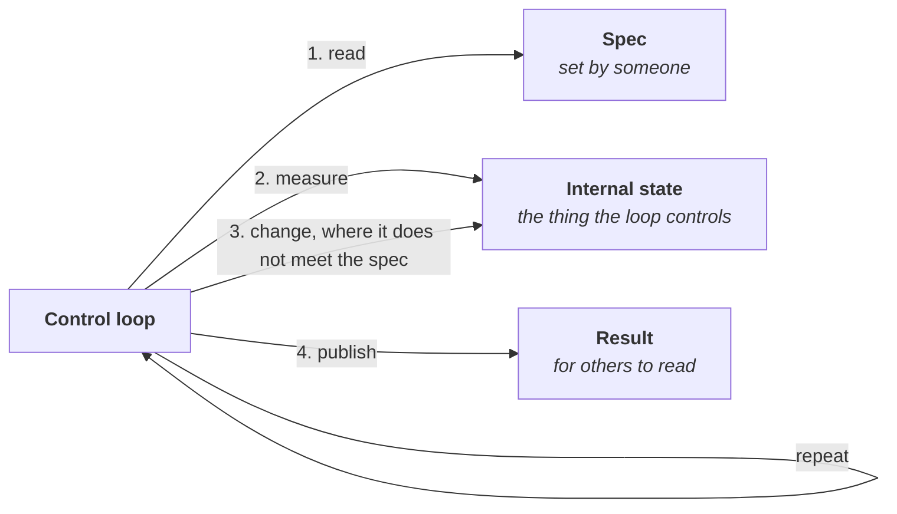

# Kubernetes Operators

A _Kubernetes Operator_ is a kind of _control loop_: a program that keeps comparing what was asked for with what actually exists, and changes what exists until it matches. The same pattern is followed by every operator in Kubernetes, both built-in and custom.

> Kubernetes docs call the built-in ones _controllers_ and reserve _operator_ for custom ones; but the mechanism is the same.

This repository builds a single illustrative operator in three ways: 
- 1). One hand-written file
- 2). Separate tested parts
- 3). Using `controller-runtime`, the _**Go**_ library that most production operators are built with.

The code then shows the mechanism at work:

- **What Kubernetes stores, and what it leaves to the operator.** Kubernetes stores the request and the operator's report on it. Acting on the request is the operator's code alone.
- **Who calls whom.** The operator makes every call: it asks the API server for the objects and their changes, and writes its report back. Its loop needs no callback from Kubernetes and no listening port ([Operator and API server](api_server/readme.md)).
- **What a library takes over.** From one version to the next, parts written by hand (the watch, the cache, the queue, the worker) are replaced by the library, until only the decision code is ours.
- **That the loop does not depend on Kubernetes.** The same core also runs as a plain web service, so it runs and is tested without a cluster.

The concept comes first, on this page. [Project Overview](#project-overview) then lists the code in reading order.

## Terms

The three things every control loop deals with, each with a thermostat as example:

- **_Spec_:** the conditions someone sets for the controlled thing. It usually covers only part of it; anything not specified is left to the loop.
  *Thermostat: 20 °C.*
- **_Internal state_:** the actual condition of the thing the loop controls and changes. It's usually much larger than the spec.
  *Thermostat: the room's temperature, and whether the heater is on.*
- **_Result_:** what the loop reports about the internal state, for others to read. It can be partial or out of date.
  *Thermostat: the display, "19.5 °C, heating".*

## _Control Loop_
A process that repeats forever:
1. read the spec;
2. measure the internal state;
3. where the internal state doesn't meet the spec, change the internal state;
4. publish a result (optional).

Because it compares spec and internal state each time, it corrects a mismatch whatever caused it: a changed spec, an outside disturbance, or an earlier failed action.

## _Operator_
A control loop in which
- **Spec** is the `spec` of an _object_ of a _resource type_, stored in the Kubernetes API server and editable by others;
- **Internal State** is the software and resources it runs: Pods, a database, cloud resources, or in the Widget example, a map in memory;
- **Result** is written to that object's `status`;
- step 3's changes are specific to that resource type, eg create or delete Pods (ReplicaSet), or fail over and back up (eg a database).

## Project Overview

**All code uses one example, the Widget.** Its spec is a number of replicas; its internal state is the number of replicas actually running, a counter in memory; its result says how many are running and whether that meets the spec. One pass adds or removes one replica, so the progress is visible.

**Three levels, in reading order.** Each level removes what the one before it lacks; [Minimal and library controllers](example/readme.md) explains what that is, and who supplies each part at each level.

| level | what it is |
|---|---|
| 1). [Minimal](example/controller/python/readme.md) | the whole loop in one **_Python_** file; everything is our code |
| 2).[Structured](control_loop/readme.md) | the same loop as separate named parts with tests, in both **_Python_** and **_Go_** alternatives; it also runs as a web service without Kubernetes | 
| 3). [Library](example/controller/go/readme.md) | the same loop on controller-runtime in **_Go_**; only `Reconcile` and the wiring are our code

**Around the code:**

- [api_server](api_server/readme.md): the three kinds of call an operator makes to the API server ("LIST", "WATCH", status `PATCH`), on one page; further detail on separate, optional pages.
- [manifests](manifests/readme.md): the Widget resource type and a sample Widget, and how to run any of the operators against a cluster.
- [CI workflow](.github/workflows/control-loop.yml): runs the tests of level 2 and compiles levels 1 and 3 on every push.